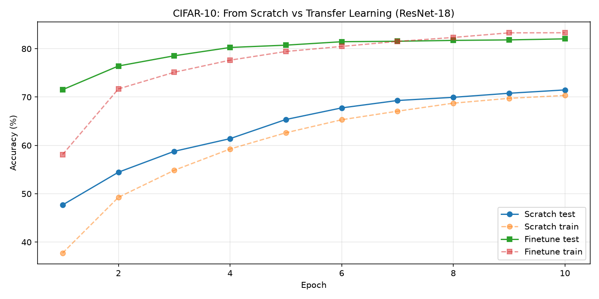
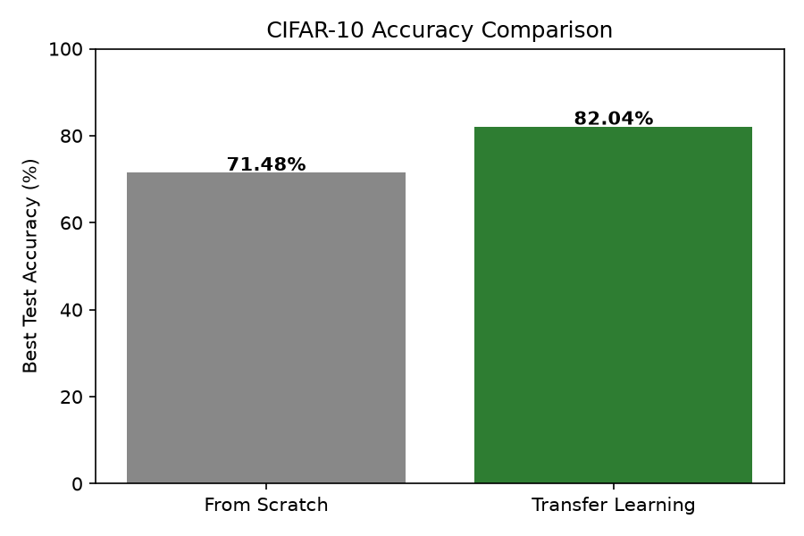

# CIFAR-10 图像分类：迁移学习 vs 从头训练

在同一数据集、同一骨干网络、同一优化策略下，用**对照实验**量化评估预训练权重的价值。

## 核心结果

| 实验 | 最佳测试准确率 |
|------|--------------|
| 从头训练（ResNet-18，随机初始化） | **71.48%** |
| 迁移学习微调（ResNet-18，ImageNet 预训练） | **82.04%** |
| 绝对提升 | **+10.56 个百分点** |

迁移学习在第 1 个 epoch 即达 71.53%，而从头训练需要跑满 10 个 epoch 才到 71.48%——
**用约 1/10 的训练预算追平了对方的终点水平**。

## 目录结构

~~~
cifar10-transfer-learning/
├── README.md                    本文件
├── requirements.txt             依赖
├── download_data.py             自动下载 CIFAR-10
├── code/
│   ├── train_cifar.py           训练主脚本（双实验对照）
│   └── plot_curve.py            可视化
├── figures/                     实验产出图
├── results/
│   └── result_summary.json      逐轮完整数据
├── docs/
│   ├── 01_方案说明.md            选题理由、控制变量设计
│   ├── 02_环境搭建.md            环境安装与踩坑记录
│   ├── 03_操作步骤.md            从零复现的 6 步教程
│   ├── 04_实验报告.md            逐轮数据、结论、局限分析
│   └── 06_代码说明.md            代码逐段讲解与扩展指南
└── data/                        数据集（不入库，见 .gitignore）
~~~

## 快速开始

~~~bash
pip install -r requirements.txt
python download_data.py

# 训练（自动依次跑两组对照实验）
python code/train_cifar.py --data-root data --epochs 10 --device cuda

# 绘图
python code/plot_curve.py
~~~

## 实验设置

| 项 | 设置 |
|----|------|
| 数据集 | CIFAR-10（训练 50000 / 测试 10000，32×32 彩色图，10 类） |
| 骨干网络 | ResNet-18（3.17M 参数） |
| 优化器 | SGD，momentum=0.9，weight_decay=5e-4 |
| 学习率 | 从头训练 2e-3 / 迁移学习 1e-3 |
| 学习率调度 | CosineAnnealingLR，T_max=epochs |
| 损失函数 | CrossEntropyLoss |
| 数据增强 | RandomCrop(32, padding=4) + RandomHorizontalFlip（仅训练集） |
| 随机种子 | 42（可复现） |

**唯一变量**是权重初始化方式；迁移学习仅替换最后一层全连接
（512→1000 的 ImageNet 分类头改为 512→10）。

## 复现环境

- Python 3.12
- PyTorch 2.11.0+cu128 / torchvision 0.26.0
- CUDA 12.8
- NVIDIA GeForce RTX 5060 Laptop (8GB VRAM)
- 耗时参考：从头训练约 175 s/epoch，迁移学习约 39 s/epoch

## 逐轮数据

| Epoch | 从头 test | 迁移 test | 差距 |
|------|----------|----------|------|
| 1 | 47.69% | 71.53% | +23.84pp |
| 5 | 65.36% | 80.74% | +15.38pp |
| 10 | 71.48% | 82.04% | +10.56pp |

完整逐轮数据见 [results/result_summary.json](results/result_summary.json)，
分析见 [docs/04_实验报告.md](docs/04_实验报告.md)。

## 已知局限

1. CIFAR-10 是 32×32 玩具级数据集，82% 不代表真实场景能力。
2. 10 轮 epoch 受时间预算限制，从头训练明显尚未收敛。
3. 单次实验，未做多种子重复报置信区间。

可改进方向见 [docs/06_代码说明.md](docs/06_代码说明.md) 的「扩展改造指南」。

## License

MIT
